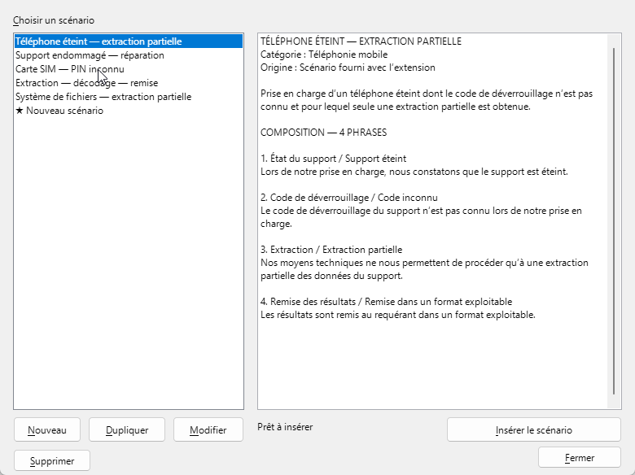

  

<h1 align="center">Lexique forensique FR</h1>

  <strong>Le vocabulaire de la criminalistique numérique, au service de vos rapports.</strong> 
  Des ressources terminologiques et rédactionnelles intégrées à LibreOffice Writer.

  
  
  

  <a href="https://github.com/jmarande/lexique-forensique-fr/releases/latest/download/lexique-forensique-fr.oxt"><strong>Télécharger l’extension</strong></a> ·
  <a href="fiches/README.md"><strong>Consulter les fiches</strong></a> ·
  <a href="docs/AIDE.md">Guide d’utilisation</a> ·
  <a href="CONTRIBUTING.md">Contribuer</a>

---

## Un outil d’aide à la rédaction en criminalistique numérique

**Lexique forensique FR** est un projet libre consacré à la terminologie et à la rédaction des rapports de criminalistique numérique. Il propose des fiches techniques, des définitions en français, des équivalents anglais, des synonymes, des termes proches et des formulations de rapport adaptées à différentes situations d’examen.

Le [catalogue des fiches](fiches/README.md) peut être consulté directement sur GitHub. L’extension permet d’utiliser ces ressources dans **LibreOffice Writer**, au cours de la rédaction d’un document.

Le projet s’organise autour de **trois modules complémentaires**, accessibles depuis Writer : le **Lexique**, les **Scénarios de rédaction** et la **Vérification du document**.

## Le projet en chiffres

| Ressource disponible | Nombre |
| --- | ---: |
| [Fiches terminologiques](fiches/README.md) | **87** |
| Formulations de rapport | **414** |
| Scénarios de rédaction | **5** |
| Règles de francisation des libellés | **18** |

*État de la base officielle au 14 octobre 2026, hors ressources personnelles. Sur les 87 fiches publiques, 4 sont indiquées comme validées et 83 restent en attente de relecture. Leur présence dans le catalogue ne constitue pas une validation systématique. Les ressources disponibles dans Writer dépendent de la version installée.*

## Trois modules complémentaires

### 1. Lexique — rechercher, comprendre et rédiger

Consulter les fiches terminologiques par recherche ou catégorie, retrouver les définitions et notions associées, puis sélectionner une formulation adaptée pour l’insérer dans un rapport. Les utilisateurs peuvent également créer leurs propres termes et formulations.

### 2. Scénarios — assembler des formulations

Construire des passages de rapport à partir de plusieurs formulations, les organiser dans un ordre cohérent et réutiliser des scénarios officiels ou personnels. Les scénarios personnels peuvent être créés, modifiés et dupliqués.

### 3. Vérification du document — harmoniser les libellés

Repérer dans un document des expressions connues, notamment des libellés en anglais provenant d’exports d’analyse numérique, et proposer leur équivalent français. Les règles personnelles permettent d’enrichir progressivement la détection et les remplacements.

### Fonctions transversales

- **Données personnelles :** conservation locale des termes, scénarios et occurrences, séparément de la base officielle.
- **Exporter / Importer :** sauvegarde au format JSON et import par fusion ou remplacement, avec sauvegarde préalable.
- **Contribution :** préparation d’une proposition de fiches depuis l’extension, soumise à relecture avant intégration.
- **Fonctionnement hors ligne :** consultation, rédaction et aide intégrée sans connexion ; celle-ci reste nécessaire pour les mises à jour et les propositions sur GitHub.

## Aperçu dans LibreOffice Writer

### Rechercher, comprendre et insérer une formulation

  

### Assembler plusieurs formulations dans un scénario

  

*Captures d’une version antérieure : certains libellés et la disposition des commandes peuvent différer de la version actuelle.*

## Installer et commencer

**Prérequis : LibreOffice 7.4 ou supérieur, avec Writer.**

1. Télécharger [**lexique-forensique-fr.oxt**](https://github.com/jmarande/lexique-forensique-fr/releases/latest/download/lexique-forensique-fr.oxt), le paquet de la dernière version publiée.
2. Ouvrir le fichier avec LibreOffice et confirmer l’installation. Redémarrer complètement LibreOffice si nécessaire.
3. Dans Writer, ouvrir **Lexique forensique > Rechercher un terme…**, puis choisir une fiche et une formulation à insérer.

Conserver le nom **`lexique-forensique-fr.oxt`** : il est nécessaire au fonctionnement de l’extension.

**Au quotidien :** le menu **Aide…** ouvre une aide consultable hors ligne. Le menu **Mettre à jour…** recherche la dernière version et présente ses notes de publication.

[Consulter les versions et leurs nouveautés](https://github.com/jmarande/lexique-forensique-fr/releases) · [Ouvrir le guide d’utilisation](docs/AIDE.md)

## Vos ressources personnelles

Vos **termes, scénarios et occurrences** sont enregistrés localement, séparément des données fournies avec l’extension. Ils sont conservés lors des mises à jour.

Le menu **Exporter / Importer…** permet de sauvegarder l’ensemble dans un fichier JSON. L’import propose de **fusionner** les données ou de **remplacer** la base personnelle, avec sauvegarde automatique préalable. Les données officielles ne sont pas écrasées par l’import.

[Comprendre le stockage et les formats de données](docs/DONNEES.md)

## Références documentaires et validation

**Le projet est indépendant.** Ses définitions et formulations sont élaborées à partir d’un référentiel documentaire commun, comprenant notamment les références **NIST, SWGDE, CLARUS D3.2, ANSSI et FranceTerme**, ainsi que d’autres publications pertinentes. Les sources sont confrontées selon le sujet, sans hiérarchie préétablie ni référence privilégiée. Les organismes cités ne sont ni éditeurs ni garants du projet.

La relecture des fiches se poursuit progressivement : une fiche disponible n’est pas nécessairement une fiche validée. Le circuit prévoit une analyse documentaire, la comparaison des concepts et une **validation humaine explicite**. Les formulations proposées restent à adapter aux constatations et aux limites de chaque examen.

Les références documentent les notions et leurs usages. Leur citation ne vaut pas autorisation de reproduction ; les conditions de réutilisation de chaque source doivent être respectées.

[Référentiel commun des sources](sources/REFERENTIEL.md) · [Méthode de relecture et de validation](docs/VALIDATION-FICHES.md)

## Participer au projet

Vous pouvez proposer un terme, préciser une définition, enrichir une formulation ou signaler un dysfonctionnement.

- **Depuis Writer :** dans **Exporter / Importer…**, sélectionner une ou plusieurs fiches personnelles et préparer leur proposition au lexique.
- **Depuis GitHub :** suivre le [guide de contribution](CONTRIBUTING.md) ou [ouvrir une issue](https://github.com/jmarande/lexique-forensique-fr/issues/new/choose).

La proposition depuis l’extension ouvre un formulaire prérempli : elle n’est publiée qu’après votre confirmation sur GitHub. Vérifiez son contenu avant publication et retirez toute donnée personnelle, confidentielle ou issue d’une procédure. Les propositions sont relues avant leur éventuelle intégration.

[Comment proposer une fiche](docs/PROPOSER-UNE-FICHE.md) · [Comment mettre à jour une fiche](docs/MISE-A-JOUR-FICHES.md)

## Documentation et suivi

| Ressource | Contenu |
| --- | --- |
| [Catalogue des fiches](fiches/README.md) | Index alphabétique, définitions et formulations de rapport. |
| [Aide utilisateur](docs/AIDE.md) | Prise en main et principaux parcours dans Writer. |
| [Extension Writer](extension/README.md) | Fonctionnement de l’extension et mises à jour. |
| [Données et organisation du dépôt](docs/DONNEES.md) | Stockage local, formats JSON et structure du projet. |
| [Sources et validation](docs/VALIDATION-FICHES.md) | Méthode documentaire et critères de relecture. |
| [Feuille de route](ROADMAP.md) | Priorités et évolutions prévues. |
| [Distribution des versions](release/README.md) | Construction du paquet OXT et publication. |

Les [issues du projet](https://github.com/jmarande/lexique-forensique-fr/issues) détaillent les travaux en cours. Les audits [initial](sources/AUDIT-INITIAL-2026-10-10.md) et [des 63 fiches au 10 octobre 2026](sources/AUDIT-63-FICHES-2026-10-10.md) restent consultables comme états historiques.

## Licence

Lexique forensique FR est distribué sous licence **GNU GPL-3.0-only**. Consulter le fichier [LICENSE](LICENSE) pour le texte intégral.
